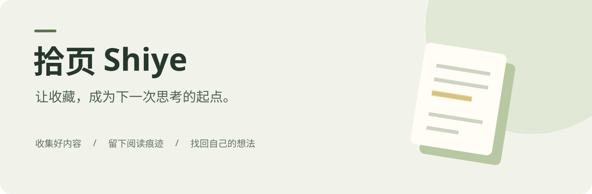

<div align="center">



# 拾页 · Shiye

### 好内容值得留下，你的想法也是。

一个轻量的个人阅读收藏工具，把文章、截图、划线和感受放在一起。

[在线体验](https://shiye-personal-library.redhaven67.chatgpt.site/library/) · [快速开始](#本地运行) · [反馈问题](https://github.com/xiucuozan-oss/shiye/issues)


</div>

---

## 从「先收藏」到「真的用上」

你可能也有这样的时刻：一篇文章很有启发，顺手点了收藏；几天后需要它，却只记得一个模糊的观点。

拾页想把这段断开的过程接起来。留下文章，也留下你为什么收藏它、哪句话打动你，以及读完后的想法。

> **收集 → 阅读 → 标注 → 记录 → 回看**

## 让每一次收藏，多留下一点东西

| 📥 收进来 | 📖 慢慢读 | ✍️ 留下想法 |
| :--- | :--- | :--- |
| 链接、文字、截图放进同一个收藏夹 | 在图文副本中阅读，选中文字划线或高亮 | 用感受和标签，记住当时的思考 |
| **🔎 找得到** | **💾 自己保存** | **🌱 轻量起步** |
| 用关键词搜索，不再翻遍各个平台 | 浏览器本地存储，支持导出、导入备份 | 围绕个人阅读流程，边用边完善 |

---

刷到有用的文章，先收藏，过几天却忘记存在哪个平台。拾页是为这个日常问题做的小工具：把文章、截图、文字和自己的想法放在一起，留下阅读的痕迹。

[体验拾页](https://shiye-personal-library.redhaven67.chatgpt.site/library/)

## 可以做什么

- **收集内容**：粘贴文章链接或分享文字，也可以手动粘贴文字、上传截图。
- **保存副本**：成功提取时保存正文和实际图片，保留来源链接与图文顺序；缺图会明确提示。
- **阅读标注**：选中文字画线、高亮，查看原图，记录自己的感受和标签。
- **整理回看**：搜索关键词，管理收藏、归档，导出和导入备份。

## 目前的边界

这是一个可用的个人项目，仍在迭代：

- 收藏、图片、标注存在当前浏览器的 IndexedDB 中，**暂不跨设备同步**。清除浏览器数据前请导出备份。
- 自动提取针对小红书、微信公众号和部分微博 HTML；平台登录、验证码和反爬限制可能导致失败，不能保证任意链接都能导入。
- 提取接口保留 Sites / ChatGPT 托管登录校验。自建环境需要接入可信的身份验证；普通静态托管不能运行这个接口。
- 本地阅读、手动收集和备份可以独立使用。没有内置在线 AI 聊天、视频下载或云端收藏数据库。
- OCR 首次使用可能需要下载模型，受网络影响。

## 本地运行

需要 Node.js 22.13 或以上版本。

```sh
npm ci
npm run dev -- --host 127.0.0.1 --port 8765
```

打开 http://127.0.0.1:8765/library/index.html 。

如只想体验本地收藏界面，也可以运行：

```sh
python3 -m http.server 8765 --directory public
```

静态模式没有 `/api/import` 服务，链接提取不可用。

## 开发与检查

```sh
npm test
node --check public/library/app.js
node --check public/library/reader.js
npx tsc --noEmit
npm run build
```

测试覆盖来源限制、HTML 解析、图片顺序、缺图提示、标注校验及备份兼容性。

## 技术与目录

| 目录 | 用途 |
| --- | --- |
| `public/library/` | 原生 JavaScript 阅读收藏界面、IndexedDB 存储、离线缓存 |
| `lib/extract.mjs` | 来源校验、正文及图片提取 |
| `app/api/import/` | 服务端提取接口 |
| `app/chatgpt-auth.ts` | 托管环境身份适配 |
| `build/`、`scripts/` | Vinext / Vite / Cloudflare 构建与运行支持 |

使用 React、Vinext、Vite、Cloudflare Workers、Tailwind CSS 和 LinkeDOM。收藏数据没有写入云数据库。

## 部署说明

`npm run build` 构建 Worker 应用；部署者需要自行配置 Cloudflare 和可信的认证入口。本仓库不包含原站点项目身份、个人收藏、平台分享令牌或部署凭据。原站点地址只是体验入口，不代表克隆仓库就能继承其登录与部署配置。

## 关于这个项目

由 Viki 使用 Codex 辅助开发：从真实的收藏与阅读需求出发，边使用、边反馈、边修改。欢迎通过 Issue 分享问题和想法，也欢迎提交 Pull Request。

## 开源许可

项目代码使用 [MIT License](LICENSE)。第三方代码保留原有许可，见 [THIRD_PARTY_NOTICES.md](THIRD_PARTY_NOTICES.md)。文章、图片和平台内容的权利属于原作者，不属于代码的 MIT 授权范围。开源版本不附带此前收藏的第三方文章和图片。
